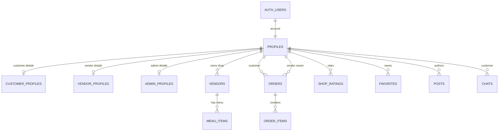

# KainHUB Database Design

## 1. Database Overview

| Item | Description |
| --- | --- |
| Database | Supabase PostgreSQL |
| Application schema | `public` |
| Authentication | Supabase Auth (`auth.users`) |
| Schema source | [`supabase/schema.sql`](./supabase/schema.sql) |
| Active application tables | 14 |

KainHUB has three portals with separate personal profile tables and shared
marketplace records. `profiles` remains the Auth account/role registry; each
account's personal details live in its matching role profile table. Orders,
shops, and other marketplace records remain shared and are protected by
row-level security (RLS), rather than duplicated per portal.

## 2. Portal Flow and Table Ownership

### Customer Portal

```text
Sign up / profile
  profiles -> customer_profiles
      |
Browse approved shops and food
  vendors -> menu_items
      |
Save shops/products ------------------------------> favorites
      |
Checkout: one order per shop
  orders -> order_items
      |
Track order and chat with shop -------------------> chats
      |
Rate completed order -----------------------------> shop_ratings
      |
Receive account alerts ---------------------------> notifications

Discover marketplace posts -----------------------> posts
```

| Customer action | Table(s) | Data flow |
| --- | --- | --- |
| Create account, edit profile | `profiles`, `customer_profiles` | `profiles` holds Auth identity and role; personal details are customer-owned. |
| Browse shops | `vendors` | Customer sees approved shops. |
| Browse food/menu | `menu_items` | Items belong to a shop through `vendor_id`. |
| Save a shop or food item | `favorites` | Private list keyed by user, target kind, and target id. |
| Place an order | `orders`, `order_items` | Checkout writes one order header per vendor and its item snapshots. |
| Track order | `orders` | Status and timeline are updated on the shared order row. |
| Message a vendor | `chats` | A conversation associates a customer with a shop. |
| Rate a shop | `shop_ratings`, `vendors` | A protected function accepts a rating only for the customer's completed order, then updates the shop aggregate. |
| Read marketplace | `posts` | Customer reads posts that are not hidden. |
| Receive alerts | `notifications` | Customer reads and updates their own recipient rows. |

The cart before checkout is browser state/local storage; there is no cart table.

### Vendor Portal

```text
Sign up / account profile
  profiles -> vendor_profiles
      |
Create and manage shop ---------------------------> vendors
      |
Manage menu and stock ----------------------------> menu_items
      |
Publish shop/product posts -----------------------> posts
      |
Receive customer's order
  orders -> order_items
      |
Accept / prepare / ready / deliver / complete
  orders.status + orders.timeline
      |
Message customer ---------------------------------> chats
      |
Receive alerts -----------------------------------> notifications
```

| Vendor action | Table(s) | Data flow |
| --- | --- | --- |
| Create account and edit personal profile | `profiles`, `vendor_profiles` | Account identity/role and vendor personal details are separate from shop data. |
| Register and manage a shop | `vendors` | The owner link, business details, approval state and open/busy/closed state live here. |
| Manage menu and inventory | `menu_items` | Each row is linked to its shop and stores current price, stock and availability. |
| Process customer orders | `orders`, `order_items` | Vendor accesses only orders associated with their account/shop, then updates order status and timeline. |
| Publish marketplace content | `posts` | Vendor-authored posts and moderation fields are stored together. |
| Message customers | `chats` | Vendor participation is resolved through the shop's id/legacy id. |
| Read account alerts | `notifications` | Notifications are addressed to a recipient. |

### Admin Portal

```text
Manage accounts ---------------------------------> profiles + role profile tables
Review / approve vendor applications ------------> vendors
Review shop catalog ------------------------------> vendors + menu_items
Monitor all orders -------------------------------> orders -> order_items
Moderate marketplace -----------------------------> posts
Review activity and analytics --------------------> orders.timeline + records
Send / read admin alerts -------------------------> notifications
```

| Admin action | Table(s) | Data flow |
| --- | --- | --- |
| Manage customer, vendor and admin accounts | `profiles`, role profile tables | The registry supplies role/status; each role table supplies personal details. |
| Approve, reject or suspend a shop | `vendors` | Shop approval is separate from the account role in `profiles`. |
| Review catalog | `vendors`, `menu_items` | Shop and menu data remain in their normal source tables. |
| Review system-wide orders | `orders`, `order_items` | Admin can review order headers, line items and order snapshots. |
| Moderate marketplace | `posts` | Hide, pin, or review reported posts. Comments and likes are embedded in post JSON as used by the app. |
| View analytics and audit activity | Existing tables | Dashboard values are calculated; audit entries are derived from `orders.timeline`. Neither is a separate persisted table. |
| Send and receive admin alerts | `notifications` | Admin desk alerts are stored once per intended recipient. |

Admin access is subject to each table's RLS policies. For example, customer
favorites are intentionally private and the admin portal does not get a blanket
read of every customer's saved list.

## 3. Shared Records and Relationships



### Database-enforced foreign keys

| Child record | Field | Parent |
| --- | --- | --- |
| `profiles` | `id` | `auth.users.id` |
| `customer_profiles` | `id` | `profiles.id` |
| `vendor_profiles` | `id` | `profiles.id` |
| `admin_profiles` | `id` | `profiles.id` |
| `vendors` | `owner_id` | `profiles.id` |
| `menu_items` | `vendor_id` | `vendors.id` |
| `orders` | `customer_id` | `profiles.id` |
| `orders` | `vendor_owner_id` | `profiles.id` |
| `order_items` | `order_id` | `orders.id` |
| `shop_ratings` | `customer_id` | `profiles.id` |
| `favorites` | `user_id` | `profiles.id` |
| `posts` | `author_id` | `profiles.id` |
| `chats` | `customer_id` | `profiles.id` |

Some app relationships use `legacy_id` instead of foreign keys for backward
compatibility: `orders.vendor_legacy_id`, `order_items.menu_legacy_id`,
`shop_ratings.vendor_legacy_id`, `posts.product_id`, `posts.vendor_legacy_id`,
`favorites.target_legacy_id`, `favorites.vendor_legacy_id`, and
`chats.vendor_legacy_id`. When working with these columns, resolve the value
against the corresponding vendor/menu `legacy_id` and fall back to its database
id only for older rows.

## 4. Table Dictionary

### 4.1 `profiles` — Shared Auth Account Registry

**Used by:** Customer, Vendor, Admin. One row per Auth account. Identity, role,
and status live here. Personal details are stored in the matching role profile
table. The old detail columns remain as synchronized compatibility fields until
all deployed clients have moved to the role tables. Vendor shop/business data is
separate again in `vendors`.

| Field | Data type | Description |
| --- | --- | --- |
| `id` | `uuid` (PK, FK → `auth.users.id`) | Auth user id and application account id. |
| `email` | `text` | Account email address. |
| `role` | `public.app_role` | `customer`, `vendor`, or `admin`. |
| `status` | `text` | Account state, such as `active` or `suspended`. |
| `full_name` | `text` | Compatibility mirror; canonical value is in the role profile. |
| `mobile` | `text` | Compatibility mirror; canonical value is in the role profile. |
| `address` | `text` | Compatibility mirror; canonical value is in the role profile. |
| `avatar` | `text` | Compatibility mirror; canonical value is in the role profile. |
| `cover_image` | `text` | Compatibility mirror; canonical value is in the role profile. |
| `created_at` | `timestamp with time zone` | Account creation time. |
| `updated_at` | `timestamp with time zone` | Last account update time. |

### 4.2 `customer_profiles`, `vendor_profiles`, `admin_profiles` — Role Profiles

**Used by:** The matching portal and admins managing accounts. Each table has
the same profile fields, but only the corresponding role owns a row. `id` is
both the primary key and a cascading foreign key to `profiles.id`. Vendor shop
details remain in `vendors`, not `vendor_profiles`.

| Field | Data type | Description |
| --- | --- | --- |
| `id` | `uuid` (PK, FK → `profiles.id`) | Auth account associated with this role-specific profile. |
| `full_name` | `text` | Account holder's name. |
| `mobile` | `text` | Account holder's mobile number. |
| `address` | `text` | Account holder's personal address. |
| `avatar` | `text` | Profile image URL. |
| `cover_image` | `text` | Profile cover image URL. |
| `created_at` | `timestamp with time zone` | Profile creation time. |
| `updated_at` | `timestamp with time zone` | Last profile update time. |

The `profiles` compatibility columns are synchronized for currently deployed
clients. New app reads/writes use the role-specific table; remove the mirror
columns only after all older clients have been retired.

### 4.3 `vendors` — Shop / Business

**Used by:** Customer (approved shop discovery), Vendor (own shop management),
Admin (review and approval).

| Field | Data type | Description |
| --- | --- | --- |
| `id` | `bigint` (PK, identity) | Database shop id. |
| `owner_id` | `uuid` (unique, FK → `profiles.id`) | Account that owns the shop; nullable on retained legacy rows. |
| `legacy_id` | `bigint` (unique) | App-facing shop id used by related records. |
| `name` | `text` | Public shop name. |
| `owner_name` | `text` | Owner name displayed with the shop. |
| `email` | `text` | Shop contact email. |
| `mobile` | `text` | Shop contact number. |
| `address` | `text` | Shop address. |
| `category` | `text` | Shop category. |
| `operating_hours` | `text` | Business hours. |
| `description` | `text` | Shop description. |
| `status` | `public.vendor_status` | Approval: `pending`, `approved`, `rejected`, or `suspended`. |
| `store_status` | `text` | Operating state such as `OPEN`, `BUSY`, or `CLOSED`. |
| `rating` | `numeric(3,2)` | Average shop rating. |
| `rating_count` | `integer` | Number of ratings used in the average. |
| `delivery_available` | `boolean` | Whether the shop offers delivery. |
| `queue` | `integer` | Current shop queue value. |
| `cover_image` | `text` | Shop cover image URL. |
| `logo` | `text` | Shop logo URL. |
| `created_at` | `timestamp with time zone` | Shop record creation time. |
| `updated_at` | `timestamp with time zone` | Last shop record update time. |

### 4.4 `menu_items` — Shop Menu and Inventory

**Used by:** Customer (browse/order), Vendor (manage), Admin (review).

| Field | Data type | Description |
| --- | --- | --- |
| `id` | `bigint` (PK, identity) | Database menu item id. |
| `vendor_id` | `bigint` (FK → `vendors.id`) | Shop that owns the item. |
| `legacy_id` | `bigint` | App-facing menu item id. |
| `name` | `text` | Product name. |
| `description` | `text` | Product description. |
| `price` | `numeric(10,2)` | Current unit price; zero or greater. |
| `stock` | `integer` | Current stock; zero or greater. |
| `available` | `boolean` | Whether it can currently be ordered. |
| `image` | `text` | Product image URL. |
| `created_at` | `timestamp with time zone` | Menu item creation time. |
| `updated_at` | `timestamp with time zone` | Last menu item update time. |

The pair (`vendor_id`, `legacy_id`) is unique.

### 4.5 `orders` — Order Header and Status Flow

**Used by:** Customer (place and track), Vendor (fulfill), Admin (monitor).

| Field | Data type | Description |
| --- | --- | --- |
| `id` | `bigint` (PK, identity) | Database order id. |
| `order_number` | `text` (unique) | Public order number. |
| `customer_id` | `uuid` (FK → `profiles.id`) | Customer who placed the order. |
| `vendor_legacy_id` | `bigint` | App-facing shop id. |
| `vendor_owner_id` | `uuid` (FK → `profiles.id`) | Vendor account responsible for the order. |
| `customer_name` | `text` | Customer name captured at checkout. |
| `customer_mobile` | `text` | Customer mobile captured at checkout. |
| `customer_address` | `text` | Customer address captured at checkout. |
| `total` | `numeric(10,2)` | Order total. |
| `payment_status` | `text` | Payment state. |
| `gcash_ref` | `text` | GCash reference when applicable. |
| `queue_number` | `integer` | Shop queue number. |
| `status` | `text` | Order stage: received, preparing, ready, delivery, completed, rejected or cancelled. |
| `fulfillment` | `text` | `DELIVERY` or `PICKUP`. |
| `reject_reason` | `text` | Reason the vendor rejected an order. |
| `payment_method` | `text` | Selected payment method. |
| `special_instructions` | `text` | Customer instructions. |
| `timeline` | `jsonb` | Order status/event history used by audit activity. |
| `created_at` | `timestamp with time zone` | Order placement time. |
| `updated_at` | `timestamp with time zone` | Last order update time. |

Each order belongs to one vendor. Checkout creates separate order headers when
one cart includes items from multiple vendors. Status changes are stored in
`status` and appended to `timeline`.

### 4.6 `order_items` — Purchased Item Snapshots

**Used by:** Customer (order detail), Vendor (prepare order), Admin (review).

| Field | Data type | Description |
| --- | --- | --- |
| `id` | `bigint` (PK, identity) | Database order-line id. |
| `order_id` | `bigint` (FK → `orders.id`) | Parent order. |
| `menu_legacy_id` | `bigint` | App-facing menu item id at purchase. |
| `name` | `text` | Product name snapshot. |
| `price` | `numeric(10,2)` | Unit price snapshot. |
| `quantity` | `integer` | Purchased quantity; greater than zero. |
| `notes` | `text` | Customer notes for this item. |

Name and price are snapshots by design, so editing a menu item does not rewrite
an existing receipt or historical order.

### 4.7 `shop_ratings` — Completed-Order Ratings

**Used by:** Customer (submit/view own rating); the protected database function
updates the shop aggregate in `vendors`.

| Field | Data type | Description |
| --- | --- | --- |
| `order_number` | `text` (PK) | Order being rated; enforces one rating per order. |
| `customer_id` | `uuid` (FK → `profiles.id`) | Customer who rated. |
| `vendor_legacy_id` | `bigint` | Rated shop id. |
| `rating` | `integer` | Score from 1 to 5. |
| `created_at` | `timestamp with time zone` | Rating submission time. |

Clients do not write this table directly. `rate_completed_order` verifies the
order belongs to the customer and is completed before saving a rating.

### 4.8 `posts` — Marketplace and Community

**Used by:** Customer (browse), Vendor (publish own posts), Admin (moderate).

| Field | Data type | Description |
| --- | --- | --- |
| `id` | `bigint` (PK, identity) | Database post id. |
| `legacy_id` | `bigint` (unique) | App-facing post id. |
| `author_id` | `uuid` (FK → `profiles.id`) | Post author; set null if account is deleted. |
| `author_name` | `text` | Author name snapshot. |
| `author_avatar` | `text` | Author image snapshot. |
| `author_role` | `public.app_role` | Author's portal role. |
| `content` | `text` | Post text. |
| `type` | `text` | Post kind. |
| `product_id` | `bigint` | App-facing product id when relevant. |
| `vendor_legacy_id` | `bigint` | App-facing shop id when relevant. |
| `product` | `jsonb` | Product/menu snapshot for a post. |
| `image_url` | `text` | Post image URL. |
| `liked_by` | `jsonb` | Liker identifiers; like count is derived from this list. |
| `comments` | `jsonb` | Embedded post comments used by the current app. |
| `pinned` | `boolean` | Whether the post is pinned. |
| `hidden` | `boolean` | Whether the post is hidden from public feeds. |
| `reported` | `boolean` | Whether the post has been reported. |
| `report_reason` | `text` | Moderation/report reason. |
| `publish_at` | `timestamp with time zone` | Scheduled or actual publish time. |
| `expires_at` | `timestamp with time zone` | Optional post expiry time. |
| `created_at` | `timestamp with time zone` | Post creation time. |
| `updated_at` | `timestamp with time zone` | Last post update time. |

Comments are embedded in `posts.comments`; the unused legacy `post_comments`
table is retired by the schema migration.

### 4.9 `favorites` — Customer Saved Items

**Used by:** Customer only. RLS intentionally prevents other accounts, including
admins, from reading a customer's private saved list.

| Field | Data type | Description |
| --- | --- | --- |
| `user_id` | `uuid` (PK part, FK → `profiles.id`) | Customer who saved the item. |
| `target_type` | `text` (PK part) | `shop` or `product`. |
| `target_legacy_id` | `bigint` (PK part) | App-facing id of the saved target. |
| `vendor_legacy_id` | `bigint` | Shop id needed to resolve a saved product. |
| `created_at` | `timestamp with time zone` | Save time. |

The composite primary key is (`user_id`, `target_type`, `target_legacy_id`).

### 4.10 `notifications` — Recipient Notifications

**Used by:** Customer, Vendor, Admin. A recipient sees only their own rows;
admin desk notifications are delivered once per admin recipient.

| Field | Data type | Description |
| --- | --- | --- |
| `id` | `bigint` (PK, identity) | Database notification id. |
| `legacy_id` | `bigint` | App-facing event id. |
| `user_id` | `text` | Recipient id; text preserves older vendor numeric identifiers. |
| `type` | `text` | Notification category. |
| `title` | `text` | Notification title. |
| `message` | `text` | Notification text. |
| `read` | `boolean` | Whether it has been read. |
| `created_at` | `timestamp with time zone` | Creation time. |
| `expires_at` | `timestamp with time zone` | Optional expiry; null means no expiry. |

The (`user_id`, `legacy_id`) unique key deduplicates retries per recipient.

### 4.11 `chats` — Customer/Vendor Messages

**Used by:** Customer and Vendor participants; Admin access follows the chat RLS
policy.

| Field | Data type | Description |
| --- | --- | --- |
| `id` | `text` (PK) | Application chat id. |
| `vendor_legacy_id` | `bigint` | Shop identifier for the conversation. |
| `customer_id` | `uuid` (FK → `profiles.id`) | Customer in the conversation. |
| `messages` | `jsonb` | Ordered messages, including supported reactions. |
| `updated_at` | `timestamp with time zone` | Last conversation update time. |

### 4.12 `activity_logs` — Portal Audit Trail

**Used by:** Admin audit screen. Database triggers record safe workflow events
for customer, vendor, and admin changes; reads are restricted to admins.

| Field | Data type | Description |
| --- | --- | --- |
| `id` | `bigint` (PK, identity) | Event identifier. |
| `actor_id` | `uuid` | Authenticated user who performed the change, when available. |
| `actor_role` | `app_role` | Portal role associated with the actor. |
| `action` | `text` | Event action, such as insert, update, or delete. |
| `entity_type` | `text` | Table or workflow entity affected. |
| `entity_id` | `text` | Identifier of the affected record, when available. |
| `details` | `jsonb` | Safe changed-field and workflow metadata; excludes chat contents, profile details, and order contact data. |
| `created_at` | `timestamp with time zone` | Event time; indexed newest-first for the audit screen. |

## 5. Organization and Safety Notes

- Table descriptions in Supabase start with portal/domain labels, making the
  shared Table Editor list scannable without renaming tables.
- Shared workflow records stay in one source of truth. A customer creates an
  order; the vendor processes that same order; admin reviews that same order.
- RLS controls which rows each portal can access. A table appearing in a portal
  map does not grant access by itself.
- Analytics are derived from existing records; `activity_logs` stores the
  persistent, trigger-generated audit trail for portal changes.
- `_canonical_columns` is a locked schema-verification helper created and
  dropped by the migration; it is not an application table.
- `customer_profiles`, `vendor_profiles`, and `admin_profiles` are the active
  personal profile tables. Compatibility fields remain mirrored in `profiles`
  until older clients are retired. `post_comments` is the retired legacy table.
- Legacy accounting columns and `removed_*` backup tables are retained when
  present; they are not active application tables.

## 6. Applying the Design

Run [`supabase/schema.sql`](./supabase/schema.sql) in the Supabase SQL Editor
to apply the full schema, including creation and backfill of role-specific
profiles, the activity audit trail, RLS policies, and compatibility triggers.
Deploy the matching frontend to switch application reads and writes to the
role profile tables.
